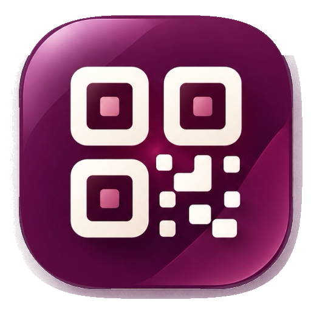

# QRLab — Official Website & Product Architecture

<div align="center">
  
  <h1>QRLab</h1>
  <p><strong>Create. Style. Scan.</strong></p>
  <p><em>Artistic 3D & Vector QR Maker with 100% On-Device Privacy.</em></p>
</div>

---

## 1. Executive Summary & Brand Positioning

- **Product Name:** QRLab
- **Primary Taglines:** *Create. Style. Scan.* / *Make QR codes, beautifully.*
- **Secondary Subtitle:** *Artistic 3D & Vector QR Maker with 100% On-Device Privacy.*
- **Developer:** Muhammad Rafiq ([Portfolio](https://mrafiq.vercel.app/) | [Email](mailto:mrafiqdot825@gmail.com))
- **Target Audience:** Freelancers, business owners, graphic designers, restaurant managers, event organizers, and developers looking for high-converting, branded QR codes.
- **Core Value Proposition:** Unlike generic black-and-white QR code generators that rely on paid subscriptions, cloud tracking, and low-res pixelated images, QRLab offers artistic module styling, eye geometry customization, curated editorial palettes, and infinite-resolution vector SVG exports—generated 100% privately on device.

---

## 2. Design System & Visual Identity (Morrow-Style Editorial Language)

QRLab features a soft, warm editorial aesthetic with pastel tiles, serif headlines, rounded tactile cards, and diffuse organic depth.

### A. Color Palette Tokens

| Token | Hex Code | Purpose & Usage |
|---|---|---|
| `--bg-canvas` | `#FBEDE6` | Page body background (warm peach cream) |
| `--bg-surface` | `#FDF6F2` | Elevated cards, section backgrounds, tactile containers |
| `--bg-card` | `#FFFFFF` | Form inputs, scannable QR quiet zone plates |
| `--ink` | `#1A1416` | Major headlines, primary high-contrast typography |
| `--ink-muted` | `#6B6468` | Paragraphs, captions, secondary descriptors |
| `--plum` | `#4A0F3A` | Primary brand accent, primary CTA pill buttons, italic accents |
| `--plum-hover` | `#5C1349` | Interactive button hover state |
| `--plum-light` | `#F7EBF3` | Subtle badge highlights and badge containers |
| `--sage` | `#C9D8BE` | Pastel feature tile (Wi-Fi Quick-Connect) |
| `--butter` | `#FBE9A8` | Pastel feature tile (Digital vCard Contacts) |
| `--peach` | `#F7B9A5` | Pastel feature tile (Messages & Phone Dialer) |
| `--lavender` | `#D9D4F5` | Pastel feature tile (Website & Social Links) |
| `--periwinkle` | `#AFC0F5` | Pastel feature tile & secondary indicators |
| `--leaf` | `#8FA67F` | Nature accents, verification icons & checkmarks |
| `--border-subtle` | `#F0E2DA` | Soft editorial card borders & dividers |

### B. Typography

- **Display Serif:** *Newsreader* (Google Fonts, subset Latin) with fluid `clamp()` sizing.
  - Signature Headline Pattern: Two-line editorial title:
    - Line 1: **Bold roman** in `--ink`
    - Line 2: ***Italic accent*** in `--plum` (e.g., *"Make QR codes, / beautifully."*)
- **UI & Body Sans:** *DM Sans* for navigation links, form controls, badges, and body copy.
- **Fluid Scale:**
  - H1: `clamp(2.5rem, 6vw, 4.5rem)`
  - H2: `clamp(1.75rem, 3.5vw, 2.75rem)`
  - Body: `16px – 18px`
  - Captions & Badges: `11px – 13px`

### C. Shape, Depth & Continuous Snap Scrolling

- **Radii:** Cards `24px – 32px`, tiles `24px`, buttons/pills fully rounded (`rounded-full`), icon frames `rounded-2xl`.
- **Soft Shadows:** Warm diffuse depth (e.g. `0 16px 36px rgba(74, 15, 58, 0.06)`).
- **Continuous Section Snapping:** Native `scroll-snap-type: y mandatory;` with `scroll-padding-top: 5.5rem;` on desktop ensures each scroll directly brings the next section into full view with header clearance. Mobile views use adaptive proximity snapping.
- **Section Navigator:** Floating vertical dot pagination indicator on desktop with real-time active pill expansion and jump-to tooltips.

---

## 3. Curated Theme Presets

QRLab provides pre-tested editorial palettes that strictly adhere to scannability standards (high-contrast dark modules on pure white backgrounds):

1. **Editorial Plum:** `#FDF6F2` → `#FBEDE6` → `#F7B9A5` (QR Modules: `#4A0F3A`)
2. **Botanical Sage:** `#FDF6F2` → `#EEF4EA` → `#C9D8BE` (QR Modules: `#1B3B2B`)
3. **Golden Butter:** `#FDF6F2` → `#FEF9E7` → `#FBE9A8` (QR Modules: `#33220A`)
4. **Soft Lavender:** `#FDF6F2` → `#F3F1FC` → `#D9D4F5` (QR Modules: `#32164A`)
5. **Peach Clay:** `#FDF6F2` → `#FDEEE9` → `#F7B9A5` (QR Modules: `#3A1308`)
6. **Midnight Ink:** `#FDF6F2` → `#FBEDE6` → `#E8DFD8` (QR Modules: `#1A1416`)
7. **Periwinkle Mist:** `#FDF6F2` → `#EBF0FD` → `#AFC0F5` (QR Modules: `#132347`)
8. **Mulberry Rose:** `#FDF6F2` → `#F7EBF3` → `#E8C2D8` (QR Modules: `#450C2C`)

---

## 4. Website Information Architecture

```
/ (Landing Page Root)
├── 1. Sticky Navigation Bar (Wordmark, Nav Links, App Download Pill)
├── 2. Hero Section (Two-Line Headline, CTAs, Live Dynamic QR Preview Widget)
├── 3. Social Proof & Metrics Strip (6+ Formats, Vector SVG, 100% On-Device, 60 FPS)
├── 4. Supported Data Formats Grid (URL, Wi-Fi, vCard, Messages, "Not sure where to start?" card)
├── 5. Visual Customization Showcase (Module Shapes, Eye Styling, Brand Badges)
├── 6. Live Interactive Studio (Payload Tabs, Form Fields, Real-Time SVG & PNG Export)
├── 7. Curated Designer Templates Gallery (Filterable Tabs, 50+ Blueprints Banner)
├── 8. Vector Export & Print Quality Section (Microscopic Zoom Comparison)
├── 9. Privacy & Offline Safety Guarantee (Zero Cloud, Zero Redirects Comparison Table)
├── 10. Optical Lens Scanner Highlight (Hardware Camera Reader & History)
├── 11. Frequently Asked Questions (FAQ Accordions)
├── 12. Final Download CTA Banner (Google Play Direct Link)
├── 13. Footer (Governance, Privacy Policy, Portfolio, Support)
└── 14. Floating Section Navigator (Desktop Snap Indicator Dots)
```

---

## 5. Technical Stack

- **Framework:** [React Router v7](https://reactrouter.com/) (Framework & SSR mode)
- **Engine:** [React 19](https://react.dev/)
- **Build Tool:** [Vite 8](https://vite.dev/)
- **Styling:** [Tailwind CSS v4](https://tailwindcss.com/) with native design tokens
- **QR Engine:** [`qrcode`](https://www.npmjs.com/package/qrcode) for client-side Reed-Solomon Error Correction Level-H encoding
- **Icons:** [Lucide React](https://lucide.dev/) + Custom botanical SVG assets
- **Language:** TypeScript 5.9

---

## 6. Getting Started & Development

### Prerequisites
- Node.js (v18.x or newer recommended)
- npm or pnpm

### Installation

```bash
# Clone the repository
git clone https://github.com/mrafiqdot825/QRLab.git
cd QRLab/website

# Install dependencies
npm install
```

### Development Server

```bash
# Start local development server with HMR
npm run dev
```

Visit `http://localhost:5173` in your browser.

### Typecheck & Build

```bash
# Validate TypeScript and React Router type definitions
npm run typecheck

# Build for production (client + SSR bundle)
npm run build

# Preview production build locally
npm run start
```

---

## 7. SEO & Open Graph Metadata

```html
<!-- Primary Meta Tags -->
<title>QRLab — Artistic 3D & Vector QR Code Maker</title>
<meta name="title" content="QRLab — Artistic 3D & Vector QR Code Maker" />
<meta
  name="description"
  content="Craft scan-stopping, custom branded QR codes with live interactive preview, custom shapes, luxury palettes, and infinite vector SVG export. 100% private & offline."
/>
<meta
  name="keywords"
  content="QR code maker, custom QR code generator, vector QR SVG, branded QR codes, Wi-Fi QR, vCard QR, offline QR creator, QRLab"
/>

<!-- Open Graph / Facebook -->
<meta property="og:type" content="website" />
<meta property="og:url" content="https://mrafiq.vercel.app/qrlab" />
<meta property="og:title" content="QRLab — Artistic 3D & Vector QR Code Maker" />
<meta
  property="og:description"
  content="Design scan-stopping QR codes with custom eye shapes, colors, logo badges, and crystal-clear vector exports. Free & 100% on-device privacy."
/>
<meta
  property="og:image"
  content="https://mrafiq.vercel.app/assets/images/play-store-feature-graphic.png"
/>

<!-- Twitter -->
<meta property="twitter:card" content="summary_large_image" />
<meta property="twitter:title" content="QRLab — Artistic 3D & Vector QR Code Maker" />
<meta
  property="twitter:description"
  content="Craft high-converting, on-brand QR codes with vector SVG export and 100% on-device privacy."
/>
<meta
  property="twitter:image"
  content="https://mrafiq.vercel.app/assets/images/play-store-feature-graphic.png"
/>
```

---

## 8. Author & License

- **Crafted with care by:** [Muhammad Rafiq](https://mrafiq.vercel.app/)
- **Contact:** [mrafiqdot825@gmail.com](mailto:mrafiqdot825@gmail.com)
- **Copyright:** &copy; 2026 QRLab. All rights reserved.

---

## 8. Author & License

- **Crafted with care by:** [Muhammad Rafiq](https://mrafiq.vercel.app/)
- **Contact:** [mrafiqdot825@gmail.com](mailto:mrafiqdot825@gmail.com)
- **Copyright:** &copy; 2026 QRLab. All rights reserved.

